# SI · Proyecto guiado «El arranque de una máquina virtual»

## Punto de partida

Cuando un ordenador no arranca, la pregunta es siempre la misma: ¿en qué momento del arranque falla? Para responderla hay que saber qué pasa desde que se pulsa el botón de encendido hasta que aparece el inicio de sesión. Eso es lo que trabaja este proyecto, sobre un ordenador que se puede romper sin miedo: una **máquina virtual**.

Vas a crear una máquina virtual en VirtualBox, instalar en ella Ubuntu Server y, después, ver su arranque por dentro, configurarlo, romperlo y recuperarlo. Tu ordenador no se toca: todo pasa dentro de la máquina virtual. Al final, comparas ese arranque con el de Windows en tu propio ordenador, solo mirando, sin cambiar nada.

Es la **UD2 · Sistemas operativos. Instalación**: virtualización, planificar e instalar un sistema operativo, particiones, el gestor de arranque, actualizar y recuperar el sistema.

**Usa la IA como guía, no para que lo haga por ti.** Pídele que te explique lo que no entiendas; **lo que se hace en la máquina lo haces tú**, sabiendo **dónde** y **para qué**. El objetivo es que lo que hagas **funcione y cumpla los requisitos** de cada paso («Comprueba que…») y que sepas **qué está pasando en cada momento del arranque**.

**El objetivo es entender cada paso:** es lo que necesitas para responder el cuestionario y preparar los exámenes.

**Evaluación.** Esta actividad guiada (**A2**) se evalúa con su lista de cotejo: cada «Comprueba que…» se cumple o no. El cuestionario de la semana (**C2**) se entrega hasta el lunes 16 de noviembre, junto con el de la otra semana. El **viernes 4 de diciembre** hay un examen parcial, **P1**, en papel, con todo lo de la 1ª evaluación, también esta actividad: la máquina virtual, las fases del arranque, el firmware, las particiones, GRUB, la recuperación, las instantáneas y el arranque de Windows; los apuntes de la UD1 y la UD2, y lo instalado con WSL en la semana del 2 al 6 (las preguntas de órdenes de Linux cuentan para la UD3, en la 2ª evaluación). Qué entra y cuánto vale cada parte: [1ª evaluación](../../programacion/1a-evaluacion.md).

---

## Antes de empezar

La teoría está en los [apuntes de la UD2](../apuntes/UD2-sistemas-operativos.md). Antes de cada paso, lee el apartado que le corresponde:

| Pasos | Apartado de los apuntes de la UD2 |
|---|---|
| 0, 1 y 2 | 5 · Máquinas virtuales |
| 3 | 6 · Instalar un sistema operativo, y 7 · Discos y particiones |
| 4 | 8 · El arranque y los gestores de arranque |
| 5 | 9 · Actualizaciones y aplicaciones, y la parte de instantáneas del 5 |
| 6, 7, 8 y 9 | 8 · El arranque y los gestores de arranque |
| 10 | La parte de Windows de los apartados 7 y 8 |

---

## Las herramientas

| Herramienta | Qué es | Pasos |
|---|---|---|
| **VirtualBox** | El hipervisor: crea y ejecuta la máquina virtual. Gratuito, para Windows, Linux y macOS | Todos |
| **Ubuntu Server 26.04 LTS** | El sistema que se instala, en una ISO de unos 2,7 GB. Es Ubuntu sin escritorio: todo se hace en el terminal | 3 a 9 |
| **El terminal de la máquina** | Dentro de la ventana de la máquina virtual. No tiene ratón: se maneja con el teclado | 3 a 8 |

La guía está probada con **VirtualBox 7.2** y **Windows 11**, los dos en inglés: los nombres de menús y botones van en inglés y, entre paréntesis, en español, por si los tuyos están en español.

**El teclado dentro de la máquina.** Al hacer clic dentro de la ventana de la máquina virtual, el teclado y el ratón pasan a la máquina. Para devolverlos a tu ordenador se pulsa la **tecla anfitrión**: en Windows y Linux, **Ctrl derecho** (VirtualBox la indica abajo a la derecha de la ventana). Si tu teclado no tiene Ctrl derecho, como pasa en muchos portátiles, en el paso 0 la cambias por **Ctrl + Alt** de la izquierda.

**El terminal de la máquina:**

- En los bloques de órdenes, **cada línea es una orden**: escríbela y pulsa **Intro** antes de escribir la siguiente.
- **No se puede pegar**: las órdenes se escriben. Dos ayudas: el **tabulador** completa nombres de archivos y órdenes, y la **flecha arriba** recupera las órdenes anteriores.
- Si la pantalla se queda quieta y no ves el *prompt* (`alumno@ubuntu-arranque:~$`) o el `login:`, pulsa **Intro**: algún mensaje del sistema lo ha tapado.

**Requisitos de tu ordenador:** la virtualización activada, unos 30 GB libres en el disco y 4 GB de memoria o más (la máquina usa 2 GB).

## Qué se trabaja

| Qué | Pasos |
|---|---|
| Qué es una máquina virtual; crearla y configurarla (memoria, procesadores, firmware, disco); su hardware, comparado con el de un ordenador real | 1 y 4 |
| El firmware UEFI, el orden de arranque y su menú de arranque | 2 y 9 |
| Planificar e instalar un sistema operativo; particiones GPT y la partición EFI | 3 |
| Las fases del arranque, vistas desde dentro del sistema | 4 |
| Actualizar el sistema e instalar y desinstalar programas con `apt` | 5 |
| Instantáneas para volver a un estado anterior | 5 y 8 |
| Configurar el gestor de arranque GRUB | 6 |
| Opciones avanzadas, parámetros del kernel y modo de recuperación | 7 |
| Un arranque que falla y cómo recuperarlo | 8 |
| Arrancar desde otro medio sin tocar lo instalado | 9 |
| El arranque de Windows comparado con el de Ubuntu | 10 |

## Plan de la semana

Cada sesión dura 50 minutos.

| Día | Sesión | Qué se hace |
|---|---|---|
| Martes 10 | 13:00 | Empezar la descarga de la ISO (paso 0) y, mientras baja, leer el apartado 5 de los apuntes de la UD2 («Máquinas virtuales»). |
| Martes 10 | 13:50 | **Paso 1** (crear la máquina) y **paso 2** (arrancarla sin sistema). |
| Jueves 12 | 10:10 | **Paso 3** (instalar Ubuntu Server). |
| Jueves 12 | 11:00 | **Paso 4** (el arranque por dentro) y **paso 5** (actualizar, instalar programas e instantánea). |
| Viernes 13 | 08:30 | **Paso 6** (el menú de GRUB) y **paso 7** (opciones avanzadas y modo de recuperación). |
| Viernes 13 | 09:20 | **Paso 8** (romper el arranque y recuperarlo), **paso 9** (arrancar desde la ISO) y **paso 10** (el arranque de Windows). Repasar con la lista final («Cómo comprobarlo»). |

**Los pasos se hacen en orden**, cada uno en la sesión que le toca según el plan de la semana: cada paso usa lo del anterior.

Cada paso tiene **Objetivo**, **Pista** (cómo se hace y lo justo para entenderlo), **Comprueba que…** y **Si te falla…** (errores típicos y cómo resolverlos). Las capturas son de una instalación real, con el usuario `piay`: en tu máquina saldrá el tuyo.

---

## Paso 0 · Preparar

**Objetivo.** Tener VirtualBox instalado, la virtualización activada, la tecla anfitrión elegida y la ISO de Ubuntu Server descargada.

**Pista.**

1. **Empieza la descarga de la ISO**, que tarda: la de **Ubuntu Server 26.04 LTS**, directamente desde el servidor de Ubuntu: [ubuntu-26.04.1-live-server-amd64.iso](https://releases.ubuntu.com/26.04/ubuntu-26.04.1-live-server-amd64.iso). Windows la muestra con unos **2,7 GB**. Mientras baja, sigue con los puntos siguientes y lee el apartado 5 de los apuntes de la UD2 («Máquinas virtuales»).
2. **Comprueba que la virtualización está activada:**
   - en Windows: clic derecho en el botón Inicio (o **Windows + X**) → **Task Manager** (*Administrador de tareas*) → **Performance** (*Rendimiento*) → **CPU**: abajo a la derecha, **Virtualisation: Enabled** o **Virtualization: Enabled** (*Virtualización: Habilitado*);
   - en Linux, en el terminal: `lscpu | grep -i virtualiz` tiene que mostrar `VT-x` (Intel) o `AMD-V` (AMD).
3. **Instala VirtualBox**, si no lo tienes:
   - en Windows: en [virtualbox.org](https://www.virtualbox.org/wiki/Downloads), *Windows hosts*; ejecuta el instalador con las opciones por defecto. Si pide instalar *Python* o *win32api* para las «Python bindings», no hacen falta: continúa sin ellas;
   - en Linux (Ubuntu): `sudo apt install virtualbox`.
4. Abre VirtualBox y, en **Help → About VirtualBox…** (*Ayuda → Acerca de VirtualBox…*), mira su versión. Esta guía está hecha con la 7.2.
5. **Mira si tu teclado tiene Ctrl derecho**, la tecla anfitrión de VirtualBox. Si no lo tiene, cámbiala: en VirtualBox, **File → Preferences… → Input → Virtual Machine** (*Archivo → Preferencias → Entrada → Máquina virtual*), haz clic en el valor de **Host Key Combo** (*Combinación de tecla anfitrión*), pulsa a la vez **Ctrl** y **Alt** de la izquierda y pulsa **OK**. No elijas **AltGr**: dentro de Ubuntu hace falta para escribir `@`, `#` o `|`.

**Comprueba que…**

- la virtualización está activada;
- VirtualBox se abre y es la versión 7.2;
- tienes una tecla anfitrión que existe en tu teclado: Ctrl derecho o, si no lo hay, Ctrl + Alt de la izquierda;
- la ISO está descargada y ocupa unos 2,7 GB (si ocupa bastante menos, la descarga se ha cortado: vuelve a descargarla).

**Si te falla…**

- *Virtualización: Deshabilitado*: hay que activarla en la BIOS/UEFI de tu ordenador (la opción se llama *Intel Virtualization Technology*, *VT-x*, *SVM* o *AMD-V*, según el fabricante). Se entra al encender, con **Supr**, **F2** o **Esc**.
- *En Linux, VirtualBox dice que falta el módulo del kernel (`vboxdrv`)*: si tu ordenador tiene Secure Boot, el módulo no se carga hasta registrar su firma. Ejecuta `sudo apt install --reinstall virtualbox-dkms`, sigue las instrucciones que pida para la clave (MOK) y reinicia.

---

## Paso 1 · Crear la máquina virtual

**Objetivo.** Una máquina virtual con UEFI, 2 GB de memoria, 2 procesadores y un disco de 25 GB, todavía sin sistema operativo.

**Qué es UEFI (o EFI).** Al encender un ordenador, lo primero que se ejecuta es el **firmware**: un programa guardado en un chip de la placa base que comprueba el hardware y busca un sistema que arrancar. Hay dos tipos:

| | BIOS (heredada, *legacy*) | UEFI |
|---|---|---|
| Qué es | El firmware de los PC desde los años 80 | El que la sustituye: lo llevan los ordenadores actuales desde hace más de diez años |
| Cómo arranca | Lee el primer sector del disco y ejecuta el pequeño programa que hay allí | Lee una partición del disco, la **partición EFI** (en FAT32), y ejecuta un programa `.efi` que hay en ella: en Ubuntu, el de GRUB |
| Qué recuerda | Solo el orden de los dispositivos | Una lista de **entradas de arranque** con nombre (`Ubuntu`, `Windows Boot Manager`…) |
| Tabla de particiones | MBR | GPT |
| Además | — | Su propio menú de arranque (*Boot Manager*) y **Secure Boot**, que solo arranca programas firmados |

**EFI** es el nombre de la primera versión, creada por Intel; **UEFI** (*Unified EFI*) es el estándar actual. Se usan como sinónimos: VirtualBox dice «EFI» y Ubuntu, «UEFI». Mucha gente sigue llamando «BIOS» a la configuración del firmware, aunque sea UEFI. Más, en el [apartado 8 de los apuntes de la UD2](../apuntes/UD2-sistemas-operativos.md#8-el-arranque-y-los-gestores-de-arranque).

Esta máquina usa UEFI, como un ordenador actual: por eso tendrá partición EFI (paso 3), entradas de arranque (paso 4) y *Boot Manager* (pasos 2 y 9).

**Pista.** En VirtualBox, botón **New** (*Nueva*). El asistente tiene tres páginas; se pasa de una a otra con **Next** (*Siguiente*):

1. **Virtual machine name and operating system:**
   - **VM Name:** `ubuntu-arranque`;
   - **VM Folder:** la que viene (`VirtualBox VMs`, en tu carpeta personal);
   - **ISO Image:** déjala **vacía** (`<not selected>`). La ISO se pone en el paso 3: primero vas a ver qué hace la máquina sin nada que arrancar;
   - **OS:** *Linux*; **OS Distribution:** *Ubuntu*; **OS Version:** *Ubuntu (64-bit)*;
   - la casilla **Proceed with Unattended Installation**, **desmarcada**.

   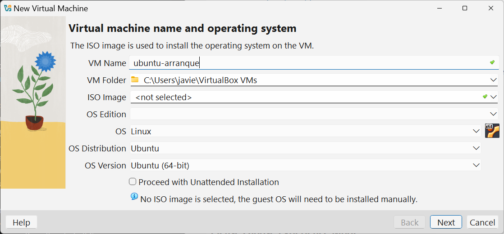

2. **Specify virtual hardware:**
   - **Base Memory:** 2048 MB;
   - **Number of CPUs:** 2;
   - **Disk Size:** 25.00 GB. El disco es **dinámico**: ocupa en tu ordenador solo lo que se use;
   - marca **Use EFI**. Es lo que hace que la máquina arranque con firmware UEFI, como un ordenador actual. **Es imprescindible**: sin EFI la máquina arranca con BIOS heredada, y los pasos 2, 3, 4 y 9 no salen como se describen (no hay partición EFI, ni `efibootmgr`, ni *Boot Manager*). Además, **después de instalar Ubuntu ya no se puede cambiar** sin reinstalar.

   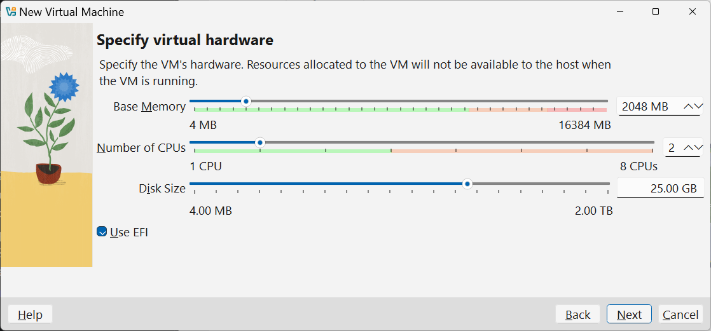

3. **Summary:** el resumen. Comprueba los datos y pulsa **Finish** (*Terminar*).

Con la máquina seleccionada en la lista, la pestaña **Details** (*Detalles*) muestra cómo ha quedado:

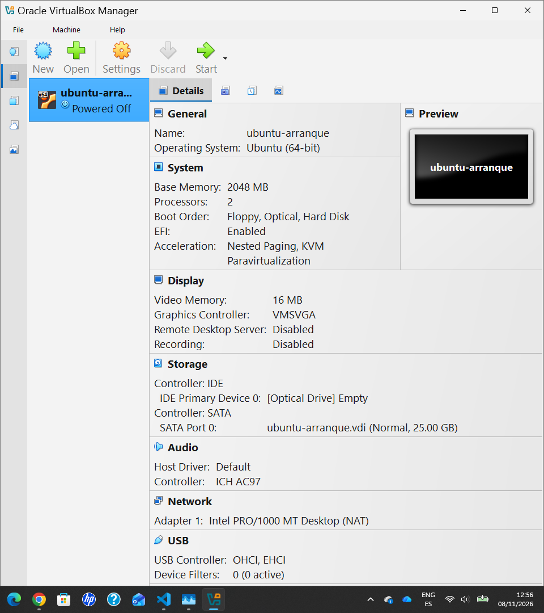

- *System → Boot Order*: el **orden de arranque**, *Floppy, Optical, Hard Disk* (disquete, DVD y disco); y **EFI: Enabled**;
- *Storage*: el DVD virtual (*[Optical Drive] Empty*, vacío) en el controlador IDE, y el disco `ubuntu-arranque.vdi` (25.00 GB) en el SATA.

**Qué son IDE y SATA.** Los discos y las unidades de DVD se conectan a la placa base a través de un **controlador de almacenamiento**, y cada controlador usa una **interfaz**: el tipo de conexión (cable y forma de comunicarse).

| | IDE (o PATA, *Parallel ATA*) | SATA (*Serial ATA*) |
|---|---|---|
| Qué es | La interfaz antigua, de los años 80 hasta mediados de los 2000 | La que la sustituyó; la de los discos y DVD actuales (los SSD más rápidos usan NVMe) |
| Cable | Ancho y plano, con dos dispositivos por cable (*maestro* y *esclavo*) | Fino, con un dispositivo por puerto |
| Velocidad | Hasta 133 MB/s | Hasta 600 MB/s |

VirtualBox simula los dos controladores, y en esta máquina cada uno tiene una unidad:

- en el **IDE** está la **unidad de DVD**. Ahí se mete la **ISO** (paso 3): un archivo que VirtualBox presenta a la máquina como si fuera un disco metido en el lector;
- en el **SATA** está el **disco duro**: el archivo `ubuntu-arranque.vdi`, que VirtualBox presenta como si fuera un disco de verdad.

Así, la máquina cree que tiene un lector de DVD y un disco duro, y en tu ordenador solo son dos archivos: la ISO y el `.vdi`. Dentro de Ubuntu, el disco aparecerá como `/dev/sda` y el DVD como `/dev/sr0` (paso 4).

Los archivos de la máquina están en la carpeta *VirtualBox VMs*, dentro de tu carpeta personal: `ubuntu-arranque.vbox` (la configuración) y `ubuntu-arranque.vdi` (el disco).

**El hardware de la máquina.** Cada ajuste de la máquina virtual es un componente de un ordenador. Para verlos, con la máquina seleccionada, pulsa **Settings** (*Configuración*) y, arriba a la izquierda, **Expert** (*Experto*): salen todos los ajustes. **Solo mira: no cambies nada** y sal con **Cancel**.

Localiza cada ajuste en la tabla «[El hardware de una máquina virtual](../apuntes/UD2-sistemas-operativos.md#el-hardware-de-una-máquina-virtual)» de los apuntes de la UD2, que dice a qué componente de un ordenador corresponde.

En el paso 4 verás este mismo hardware desde dentro de Ubuntu.

**Comprueba que…** la máquina aparece en la lista de VirtualBox, con EFI habilitado, 2048 MB de memoria, 2 procesadores, el disco de 25 GB y el DVD vacío, y sabes a qué componente de un ordenador corresponde cada ajuste de la tabla.

**Si te falla…**

- *Solo aparecen versiones de 32 bits en «OS Version»*: la virtualización no está activada (paso 0).
- *No marcaste «Use EFI»*: márcalo en **Settings → System → Motherboard** (*Configuración → Sistema → Placa base*), en *Features*, casilla **UEFI**.
- *Cambiaste algún ajuste sin querer*: pulsa **Cancel** al salir de *Settings* y no se guarda nada.

---

## Paso 2 · Arrancar sin sistema

**Objetivo.** Ver qué hace el firmware cuando no tiene nada que arrancar, y conocer su configuración y su menú de arranque.

**Pista.**

1. Con la máquina seleccionada, pulsa **Start** (*Iniciar*). Se abre su ventana: es la pantalla del ordenador virtual.
2. VirtualBox muestra dos avisos suyos, no de la máquina:
   - un recuadro a la derecha, **Auto capture keyboard**: explica lo del teclado. Ciérralo;
   - un cuadro **The virtual machine failed to boot**, que ofrece meter una ISO en el DVD. Marca **Do not show this dialog again** y pulsa **Cancel**: ahora no queremos ninguna ISO.
3. Arriba, el **firmware** ha escrito esto:

   ```
   BdsDxe: failed to load Boot0001 "UEFI VBOX HARDDISK VB…" from PciRoot(0x0)/…: Not Found
   BdsDxe: No bootable option or device was found.
   BdsDxe: Press any key to enter the Boot Manager Menu.
   ```

   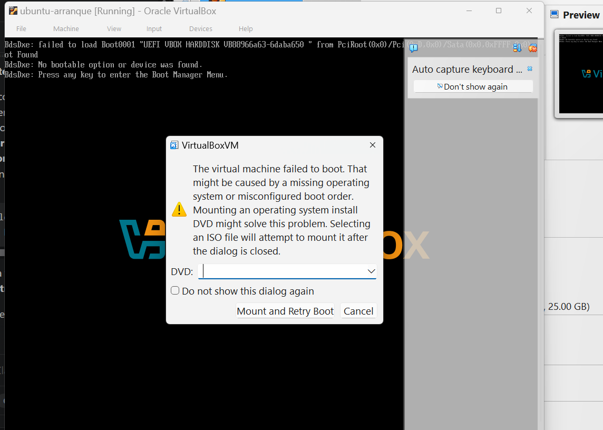

   Es la **fase 1** del arranque. El firmware UEFI ha probado el disco (`Boot0001`, *UEFI VBOX HARDDISK*), pero el disco está vacío: no tiene partición EFI ni ningún programa de arranque (`Not Found`). La unidad de DVD tampoco tiene nada. Así que no hay nada que arrancar.
4. Haz clic dentro de la ventana. VirtualBox avisa de que el teclado y el ratón pasan a la máquina (**You have clicked the mouse inside…**): marca **Do not show this message again** y pulsa **Capture**.
5. Pulsa **Intro**: se abre la **configuración del firmware**, como la BIOS/UEFI de un ordenador real. Se maneja con las flechas, **Intro** y **Esc**. Arriba pone `0 MB RAM`: es un fallo de cómo lo muestra el firmware de VirtualBox; la máquina tiene sus 2048 MB.

   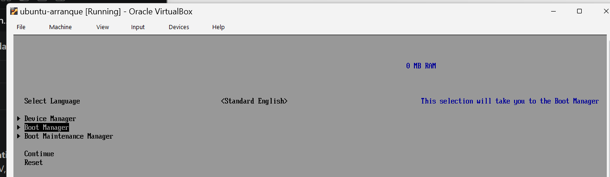

   | Opción | Qué es |
   |---|---|
   | *Device Manager* | La configuración de los dispositivos |
   | *Boot Manager* | El **menú de arranque**: elegir con qué arrancar esta vez |
   | *Boot Maintenance Manager* | Cambiar las entradas de arranque y su orden |
   | *Continue* / *Reset* | Seguir con el arranque / reiniciar |

6. Entra en **Boot Manager**. Hay tres opciones:

   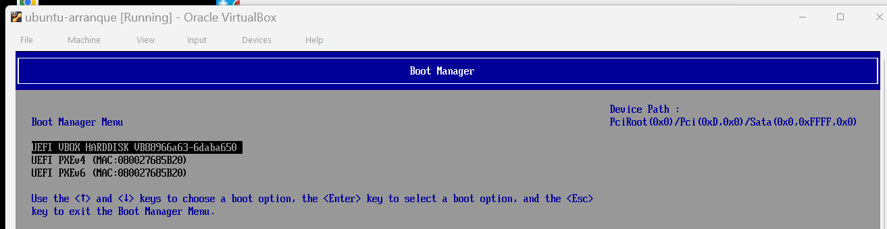

   - `UEFI VBOX HARDDISK VB…`: el **disco**. El firmware lo ve, pero ya sabes que no tiene nada que arrancar;
   - `UEFI PXEv4 (MAC:…)` y `UEFI PXEv6 (MAC:…)`: **arrancar por la red** (PXE, con IPv4 o IPv6), por si en la red hubiera un servidor que ofreciera un sistema. En esta red no lo hay.

   El DVD no aparece porque está vacío. No elijas ninguna: sal con **Esc**.
7. Apaga la máquina. Suelta el ratón con la tecla anfitrión y, en el menú de la ventana, **File → Close…** (*Archivo → Cerrar…*). El cuadro tiene tres opciones:

   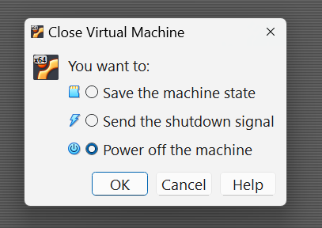

   - **Save the machine state** (*Guardar el estado*): congela la máquina tal como está, como hibernar;
   - **Send the shutdown signal** (*Enviar la señal de apagado*): pide al sistema que se apague ordenadamente, como pulsar el botón de apagado;
   - **Power off the machine** (*Apagar la máquina*): como desenchufarla.

   Elige **Power off the machine** y **OK**: sin sistema, desenchufarla no estropea nada.

**El motor de VirtualBox.** En la barra de abajo de la ventana de la máquina hay un icono con un chip verde. Si pasas el ratón por encima, dice cómo funciona: si en **Execution Engine** pone **native API**, VirtualBox está funcionando a través de **Hyper-V**, el hipervisor de Windows, porque está activo (lo usan WSL y algunas funciones de seguridad de Windows). Funciona igual, pero más despacio en los momentos de mucho trabajo, como la instalación del paso 3 (por qué: [apuntes de la UD2, apartado 5](../apuntes/UD2-sistemas-operativos.md#5-máquinas-virtuales)).

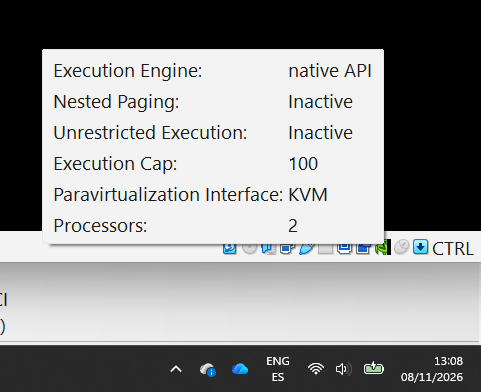

**Comprueba que…** has visto el mensaje `No bootable option or device was found`, las tres opciones del *Boot Manager*, y sabes por qué el disco no arranca y por qué no aparece el DVD.

**Si te falla…**

- *No sale el mensaje y la pantalla se queda en negro con un cursor*: espera unos segundos; si sigue igual, apaga la máquina y comprueba en **Settings → System → Motherboard**, en *Features*, que la casilla **UEFI** está marcada.
- *Las teclas no hacen nada*: haz clic dentro de la ventana de la máquina para que el teclado vaya a ella.
- *El ratón se queda dentro de la máquina y no sale*: pulsa la tecla anfitrión. Si no tienes Ctrl derecho y aún no la has cambiado, pulsa **Ctrl + Alt + Supr** y, en la pantalla de Windows, **Cancel** (*Cancelar*): recuperas el ratón. Después cámbiala como dice el punto 5 del paso 0.
- *El cuadro «The virtual machine failed to boot» sale una y otra vez*: es porque el firmware reintenta el arranque. Marca **Do not show this dialog again** y pulsa **Cancel**.
- *Error al iniciar que habla de VT-x o AMD-V*: la virtualización no está activada (paso 0).

---

## Paso 3 · Instalar Ubuntu Server

**Objetivo.** Ubuntu Server instalado en el disco de la máquina, en dos particiones: la EFI y la raíz.

**Pista.**

**Antes de instalar, comprueba que la máquina tiene UEFI**: con la máquina apagada, en **Settings → System → Motherboard**, la casilla **Enable EFI** tiene que estar marcada. Si no lo está, márcala ahora: el instalador prepara el disco para el firmware que encuentra, y después ya no se puede cambiar sin reinstalar.

1. **Mete la ISO en el DVD virtual.** Con la máquina apagada: **Settings → Storage** (*Configuración → Almacenamiento*). En *Controller: IDE*, selecciona la unidad **Empty** (*Vacío*); a la derecha, junto a *Optical Drive*, pulsa el **icono pequeño del disco** y elige **Choose a Disk File…** (*Seleccionar un archivo de disco…*): la ISO descargada. Pulsa **OK**.

   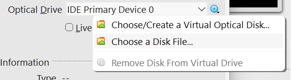

   En *Details*, en *Storage*, el DVD tiene ahora la ISO (`ubuntu-26.04.1-live-server-amd64.iso`).
2. **Inicia la máquina.** Ahora el firmware encuentra la ISO y arranca desde ella. Lo primero que aparece es **el GRUB de la ISO**: elige **Try or Install Ubuntu Server** y pulsa **Intro**.

   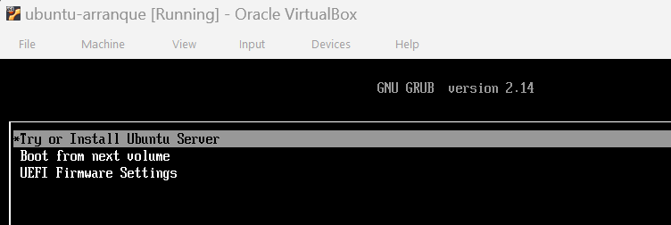

   **Qué es GRUB.** Es el **gestor de arranque** de Linux: el programa que el firmware ejecuta después de comprobar el hardware. Hace dos cosas: si hay varias opciones, muestra un **menú** para elegir una (con cuenta atrás: si no se toca nada, arranca la primera); y **carga en memoria el kernel** del sistema elegido, que pone en marcha todo lo demás. La ISO trae su propio GRUB, con las opciones de la ISO: instalar, probar el sistema… Al instalar, Ubuntu pondrá otro GRUB en el disco, el que verás a partir del paso 6. Más, en el [apartado 8 de los apuntes de la UD2](../apuntes/UD2-sistemas-operativos.md#8-el-arranque-y-los-gestores-de-arranque).

   Salen muchos mensajes del kernel, que carga los drivers de los dispositivos virtuales. Tarda **un par de minutos** hasta la primera pantalla del instalador.
3. **Sigue el instalador.** Se maneja con las flechas, el **tabulador**, la **barra espaciadora** (marcar y desmarcar) e **Intro**; para avanzar, **Done** (*Hecho*). Puedes elegir el idioma del instalador que quieras; aquí van los nombres en inglés:
   - **Language:** *English* o *Español*;
   - si sale **Installer update available**, elige **Continue without updating**;
   - **Keyboard configuration:** **Layout** *Spanish*, **Variant** *Spanish*;
   - **Choose the type of installation:** deja **Ubuntu Server** y **no marques** *Search for third-party drivers*;
   - **Network configuration:** la máquina recibe una dirección automáticamente. Junto a `enp0s3`, la tarjeta de red virtual, salen dos: **`10.0.2.15/24`** (*DHCPv4*) y otra que empieza por **`fd`** (*DHCPv6*). Qué son: «[La red de la máquina: NAT](../apuntes/UD2-sistemas-operativos.md#la-red-de-la-máquina-nat)», en los apuntes de la UD2. No cambies nada;
   - **Proxy configuration:** vacío;
   - **Ubuntu archive mirror configuration:** el instalador comprueba la réplica de la que descargará los paquetes (`es.archive.ubuntu.com`). Cuando arriba diga **This mirror location passed tests**, pulsa **Done**, aunque el registro de abajo termine en `Reading package lists...`;
   - **Guided storage configuration:** deja marcado **Use an entire disk**, el de 25 GB, y **desmarca** **Set up this disk as an LVM group**. Así las particiones quedan simples y se ven tal cual;

     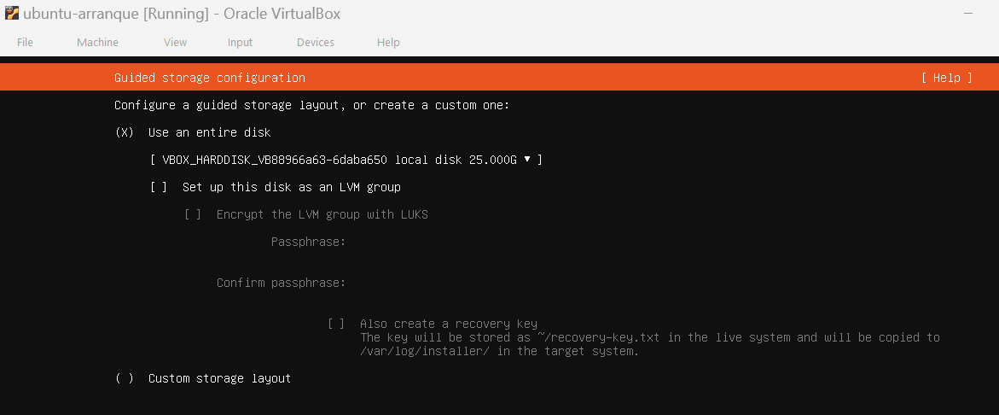

   - **Storage configuration:** el resumen muestra dos particiones: la **EFI**, que el instalador llama **ESP** (*EFI System Partition*), de 1 GB, `fat32`, montada en `/boot/efi`; y la **raíz**, el resto (unos 24 GB), `ext4`, montada en `/`. Pulsa **Done** y, en **Confirm destructive action**, **Continue**: borra el disco, y es el disco virtual, vacío;

     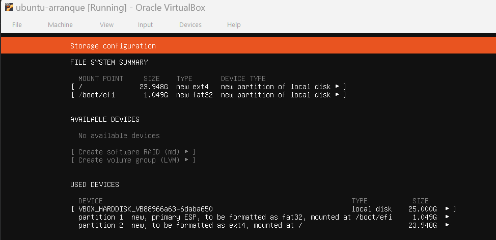

   - **Profile configuration:** tu nombre, el nombre del servidor (`ubuntu-arranque`), un nombre de usuario y una contraseña. **Apúntalos:** los necesitas para entrar y para `sudo`;

     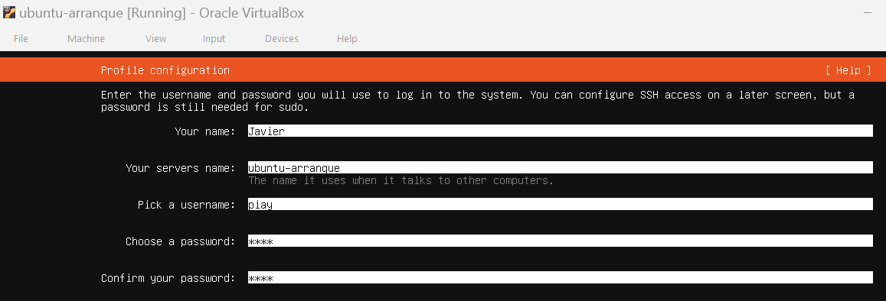

   - **Upgrade to Ubuntu Pro:** **Skip for now** y **Continue**;
   - **SSH configuration:** deja **Install OpenSSH server** sin marcar;
   - **Featured server snaps:** no marques ninguno.
4. **Empieza la instalación.** Formatear, copiar el sistema e instalar el kernel y GRUB tarda unos **5 minutos**. Después, *downloading and installing security updates* (las actualizaciones) tarda unos **20 minutos**. Pueden salir en rojo avisos como `watchdog: BUG: soft lockup - CPU#0 stuck for 90s!`: el kernel avisa de que un procesador virtual ha estado parado, por el modo *native API* del paso 2. **No pasa nada: espera.** Mientras tanto, abajo sale el botón **Cancel update and reboot**: no lo pulses, espera a que salga **Reboot Now**. Es posible que la instalación se bloquee y no avance nada durante mucho rato: en ese caso, reiniciar el sistema operativo anfitrión (Windows) y volver a abrir la máquina suele desbloquearla.

   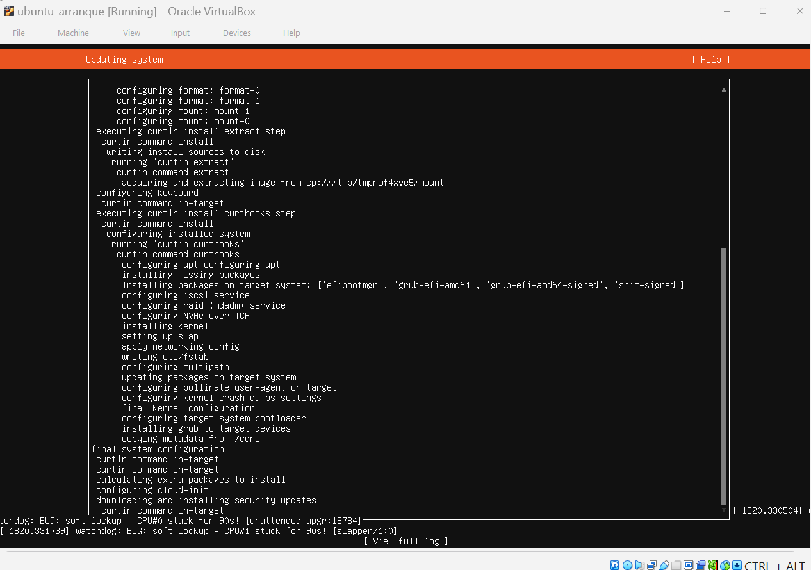

5. Cuando termina, abajo aparece **Reboot Now**. **Antes de pulsarlo, quita la ISO:** suelta el ratón y, en el menú de la ventana, **Devices → Optical Drives → Remove Disk From Virtual Drive** (*Dispositivos → Unidades ópticas → Eliminar disco de la unidad virtual*). Como el instalador aún la está usando, pregunta: **Force Unmount**.

   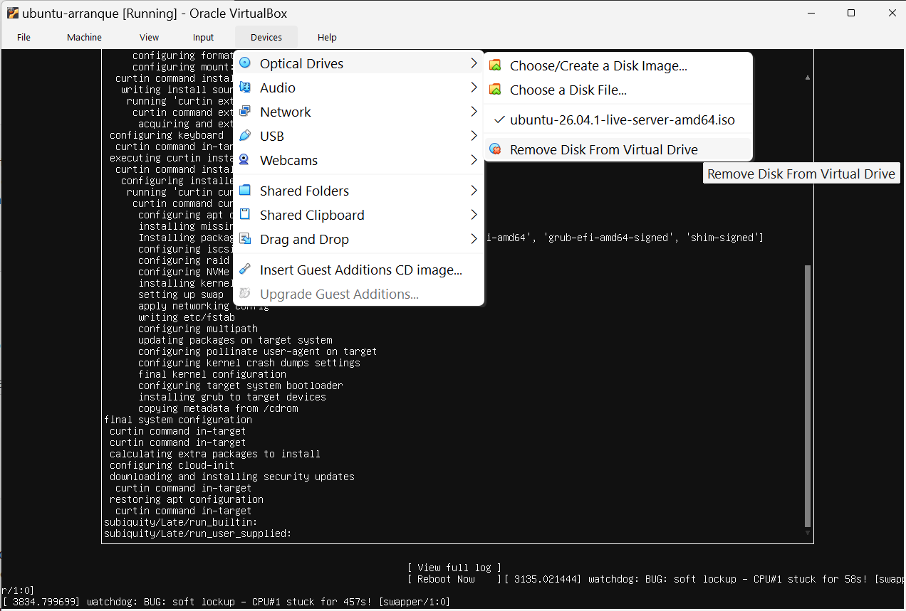

6. Ahora sí, **Reboot Now**.
7. La máquina arranca desde el disco. En este **primer arranque**, **cloud-init** termina de configurar el sistema y escribe muchos mensajes (las claves de la máquina, con unos dibujos de símbolos), que suelen tapar el `login:`. Pulsa **Intro** y sale `ubuntu-arranque login:`. Escribe tu usuario y tu contraseña (la contraseña no se ve al escribirla).

**Comprueba que…**

- arranca sin la ISO y llegas al `login:`;
- entras con tu usuario y aparece el *prompt*, algo como `alumno@ubuntu-arranque:~$`, con un mensaje de bienvenida que muestra la versión del kernel, el uso del disco y la dirección `10.0.2.15`.

**Si te falla…**

- *El instalador no reconoce las teclas como en tu teclado (por ejemplo, la `ñ` o los símbolos)*: en **Keyboard configuration** no elegiste *Spanish*. Sigue: se puede cambiar después con `sudo dpkg-reconfigure keyboard-configuration`.
- *Después de «Reboot Now» la pantalla se queda en negro con un cursor parpadeando*: la instalación ya ha terminado; lo que se ha quedado colgado es el reinicio. Espera dos minutos; si sigue igual, **File → Close… → Power off the machine** y **Start**.
- *Al reiniciar vuelve a salir el instalador*: no has quitado la ISO. Apaga la máquina, quítala en **Settings → Storage** (icono del disco → **Remove Disk From Virtual Drive**) y vuelve a iniciarla.
- *Login incorrect*: revisa la contraseña, y que no tienes las mayúsculas activadas.

---

## Paso 4 · El arranque por dentro

**Objetivo.** Ver, desde el sistema ya arrancado, dónde está cada pieza de las fases del arranque.

**Pista.** Entra con tu usuario y escribe estas órdenes, una a una. Debajo de cada una, qué mirar. Las que llevan `sudo` piden tu contraseña, con este mensaje: `[sudo: authenticate] Password:`.

1. **Los discos y las particiones:**

   ```bash
   lsblk
   ```

   ```
   NAME   MAJ:MIN RM  SIZE RO TYPE MOUNTPOINTS
   loop0    7:0    0 50.1M  1 loop /snap/snapd/27710
   loop1    7:1    0 66.8M  1 loop /snap/core24/1643
   loop2    7:2    0  1.5M  1 loop /snap/hwctl/123
   sda      8:0    0   25G  0 disk
   ├─sda1   8:1    0    1G  0 part /boot/efi
   └─sda2   8:2    0 23.9G  0 part /
   sr0     11:0    1 1024M  0 rom
   ```

   `sda` es el disco virtual; `sda1`, la partición EFI, montada en `/boot/efi`; `sda2`, la raíz, montada en `/`. `sr0` es la unidad de DVD virtual, ahora vacía. Los `loop` no son discos: son **snaps**, programas que vienen en un archivo comprimido que se monta como si fuera un disco (los números pueden cambiar).

2. **El tipo de tabla de particiones y el formato de cada partición:**

   ```bash
   sudo fdisk -l /dev/sda
   ```

   ```
   Disk /dev/sda: 25 GiB, 26843545600 bytes, 52428800 sectors
   Disk model: VBOX HARDDISK
   …
   Disklabel type: gpt
   Disk identifier: DD68CE81-EC71-4CF0-AD37-C2FBCE409B38

   Device       Start      End  Sectors  Size Type
   /dev/sda1     2048  2203647  2201600    1G EFI System
   /dev/sda2  2203648 52426751 50223104 23.9G Linux filesystem
   ```

   `Disklabel type: gpt`: la tabla de particiones es GPT. `Disk identifier`: el identificador único del disco, propio de GPT. Y el tipo de cada partición: `EFI System` y `Linux filesystem`.

3. **Lo que ejecuta el firmware (fase 1 → 2):**

   ```bash
   sudo ls /boot/efi/EFI/ubuntu
   ```

   ```
   BOOTX64.CSV  grub.cfg  grubx64.efi  mmx64.efi  shimx64.efi
   ```

   El firmware ejecuta `shimx64.efi`, que está firmado (por **Secure Boot**) y arranca `grubx64.efi`, que es GRUB. `grub.cfg` es muy corto: solo le dice a GRUB dónde está su configuración de verdad, `/boot/grub/grub.cfg`. `mmx64.efi` gestiona las claves de Secure Boot y `BOOTX64.CSV` sirve para volver a crear la entrada de arranque si se pierde. Hace falta `sudo` porque la partición EFI solo la puede leer el administrador.

4. **Las entradas de arranque que guarda el firmware:**

   ```bash
   sudo efibootmgr
   ```

   ```
   BootCurrent: 0003
   Timeout: 0 seconds
   BootOrder: 0003,0000,0001
   Boot0000* UiApp        FvVol(…)/FvFile(…)
   Boot0001* UEFI VBOX HARDDISK VB…   PciRoot(0x0)/…{auto_created_boot_option}
   Boot0003* Ubuntu       HD(1,GPT,…)/\EFI\ubuntu\shimx64.efi
   ```

   - `Boot0003* Ubuntu`: la entrada que creó el instalador. Apunta a la **partición 1** del disco GPT y al archivo **`shimx64.efi`**: es la fase 1 → 2, escrita tal cual;
   - `Boot0001`: la entrada genérica del disco, la que falló en el paso 2;
   - `Boot0000* UiApp`: el menú de configuración del firmware del paso 2;
   - `BootOrder` es el orden en que el firmware prueba las entradas (primero Ubuntu), y `BootCurrent`, la que se ha usado en este arranque.

5. **Lo que carga GRUB (fase 2 → 3):**

   ```bash
   ls /boot
   ```

   ```
   System.map-7.0.0-30-generic  config-7.0.0-43-generic      initrd.img                   vmlinuz.old
   System.map-7.0.0-43-generic  efi                          initrd.img-7.0.0-30-generic  vmlinuz
   config-7.0.0-30-generic      grub                         initrd.img-7.0.0-43-generic  vmlinuz-7.0.0-30-generic
   initrd.img.old               vmlinuz-7.0.0-43-generic
   ```

   `vmlinuz-…` es el kernel; `initrd.img-…`, su ayudante (el *initrd*); `grub`, la carpeta de configuración de GRUB; `efi`, donde está montada la partición EFI. Los nombres terminan en la versión del kernel, y hay **dos versiones**: `7.0.0-30` (la que traía la ISO) y `7.0.0-43` (la que instalaron las actualizaciones del paso 3). Los números dependen del día en que se instala: en tu máquina pueden ser otros. `vmlinuz` e `initrd.img` apuntan al kernel actual, y `vmlinuz.old` e `initrd.img.old`, al anterior. Se ve mejor en el paso 5, con `tree`.

6. **Los parámetros que GRUB le pasó al kernel en este arranque:**

   ```bash
   cat /proc/cmdline
   ```

   ```
   BOOT_IMAGE=/boot/vmlinuz-7.0.0-43-generic root=UUID=56d1ce1a-… ro crashkernel=2G-4G:320M,…
   ```

   El kernel que se cargó; la partición raíz, por su identificador (el UUID); `ro`, que la monta primero en solo lectura, y systemd la pasa después a lectura y escritura; y `crashkernel`, que reserva memoria para guardar información si el kernel se cuelga.

7. **El primer programa (fase 4):**

   ```bash
   ps -p 1
   ```

   ```
       PID TTY          TIME CMD
         1 ?        00:00:03 systemd
   ```

   El proceso número 1 es `systemd`.

8. **Cuánto ha tardado cada fase:**

   ```bash
   systemd-analyze
   ```

   ```
   Startup finished in 2.238s (kernel) + 6.114s (initrd) + 13.578s (userspace) = 21.931s
   graphical.target reached after 13.576s in userspace.
   ```

   El kernel, su ayudante (`initrd`) y los servicios (*userspace*): son las fases del arranque (apartado 8 de los apuntes de la UD2), medidas. El firmware de VirtualBox no informa de su tiempo ni del de GRUB; en un ordenador real salen también `(firmware)` y `(loader)`.

9. **El hardware que ve Ubuntu.** El mismo de la tabla del paso 1, visto desde dentro:

   ```bash
   nproc
   free -h
   lspci
   ```

   ```
   2
                  total        used        free      shared  buff/cache   available
   Mem:           1.6Gi       207Mi       1.1Gi       1.0Mi       344Mi       1.4Gi
   Swap:          2.0Gi          0B       2.0Gi
   00:00.0 Host bridge: Intel Corporation 440FX - 82441FX PMC [Natoma] (rev 02)
   00:01.0 ISA bridge: Intel Corporation 82371SB PIIX3 ISA [Natoma/Triton II]
   00:01.1 IDE interface: Intel Corporation 82371AB/EB/MB PIIX4 IDE (rev 01)
   00:02.0 VGA compatible controller: VMware SVGA II Adapter
   00:03.0 Ethernet controller: Intel Corporation 82540EM Gigabit Ethernet Controller (rev 02)
   00:04.0 System peripheral: InnoTek Systemberatung GmbH VirtualBox Guest Service
   00:05.0 Multimedia audio controller: Intel Corporation 82801AA AC'97 Audio Controller (rev 01)
   00:06.0 USB controller: Apple Inc. KeyLargo/Intrepid USB
   00:07.0 Bridge: Intel Corporation 82371AB/EB/MB PIIX4 ACPI (rev 08)
   00:0b.0 USB controller: Intel Corporation 82801FB/FBM/FR/FW/FRW (ICH6 Family) USB2 EHCI Controller
   00:0d.0 SATA controller: Intel Corporation 82801HM/HEM (ICH8M/ICH8M-E) SATA Controller [AHCI mode] (rev 02)
   ```

   - `nproc`: los **2 procesadores**;
   - `free -h`: la memoria. Sale `1.6Gi` y no 2: el kernel aparta una parte para él y para el `crashkernel` (con 2–4 GB, 320 MB). `Swap` es el archivo de intercambio que creó el instalador;
   - `lspci`: los dispositivos de la placa. Los *bridge* son el **chipset PIIX3**; *IDE interface*, el controlador del DVD; *VGA … SVGA II*, la gráfica **VMSVGA**; *Ethernet … 82540EM*, la tarjeta **Intel PRO/1000**; *SATA controller … AHCI*, el controlador del disco; los *USB controller*, el USB 2.0; y *VirtualBox Guest Service*, un dispositivo propio de VirtualBox. El sistema invitado ve exactamente el hardware que le da el hipervisor.

**Comprueba que…** sabes señalar, en la salida de estas órdenes, la partición EFI, la raíz, el programa de GRUB, la entrada de Ubuntu en el firmware, el kernel, sus parámetros y systemd, y a qué fase del arranque corresponde cada uno; y que reconoces en `lspci` el hardware de la tabla del paso 1.

**Si te falla…**

- *`sudo: … incorrect password` o `Authentication failure`*: es la contraseña de tu usuario, la del paso 3.
- *`lsblk` muestra `ubuntu--vg-ubuntu--lv` en lugar de `sda2`*: en el paso 3 quedó marcado LVM. Todo funciona igual; la raíz está dentro de LVM, un sistema de volúmenes que permite cambiar los tamaños más adelante.

---

## Paso 5 · Actualizar, instalar programas y tomar una instantánea

**Objetivo.** Dejar el sistema actualizado, instalar y desinstalar un programa con `apt`, y guardar ese estado en una instantánea para poder volver a él.

**Pista.**

1. **Actualiza el sistema.** Primero se descarga la lista de paquetes de los repositorios y después se actualiza lo instalado:

   ```bash
   sudo apt update
   sudo apt upgrade
   ```

   `apt update` no instala nada: solo dice cuántos paquetes se pueden actualizar. `apt upgrade` los actualiza; cuando pregunte `Do you want to continue? [Y/n]`, escribe `Y` e **Intro**. Tarda **unos 10 minutos**. Al final, **needrestart** mira qué hay que reiniciar después de actualizar: `Running kernel seems to be up-to-date` (el kernel en marcha ya es el último), los servicios que ha reiniciado (`Restarting services`) y los que deja para más tarde (`Service restarts being deferred`). Si no vuelve a salir el *prompt*, pulsa **Intro**.
2. **Instala un programa.** `tree` muestra una carpeta y lo que tiene dentro, en forma de árbol:

   ```bash
   sudo apt install tree
   tree -L 1 /boot
   ```

   `apt install` puede avisar de que hay paquetes que ya no hacen falta (`The following packages were automatically installed and are no longer required: linux-image-…-7.0.0-30… Use 'sudo apt autoremove' to remove them`). Son los del **kernel anterior**: **no ejecutes `autoremove`**, porque ese kernel se usa en el paso 7.

   `-L 1` dice que muestre solo un nivel:

   ```
   /boot
   ├── config-7.0.0-30-generic
   ├── config-7.0.0-43-generic
   ├── efi
   ├── grub
   ├── initrd.img -> initrd.img-7.0.0-43-generic
   ├── initrd.img-7.0.0-30-generic
   ├── initrd.img-7.0.0-43-generic
   ├── initrd.img.old -> initrd.img-7.0.0-30-generic
   ├── System.map-7.0.0-30-generic
   ├── System.map-7.0.0-43-generic
   ├── vmlinuz -> vmlinuz-7.0.0-43-generic
   ├── vmlinuz-7.0.0-30-generic
   ├── vmlinuz-7.0.0-43-generic
   └── vmlinuz.old -> vmlinuz-7.0.0-30-generic

   3 directories, 12 files
   ```

   Las flechas (`->`) son **enlaces**: `vmlinuz` apunta al kernel nuevo y `vmlinuz.old`, al anterior. Se ven también la carpeta `grub` y la carpeta `efi`, donde está montada la partición EFI: las piezas del arranque del paso 4.
3. **Desinstálalo:**

   ```bash
   sudo apt remove tree
   tree -L 1 /boot
   ```

   Al quitar, `apt` siempre pregunta (`Continue? [Y/n]`): escribe `Y`. Después, `tree` ya no existe: sale `-bash: /usr/bin/tree: No such file or directory`, porque bash recuerda dónde encontró la orden la última vez. En una sesión nueva sale `Command 'tree' not found`.
4. **Toma una instantánea, con la máquina apagada.** Apágala desde Ubuntu:

   ```bash
   sudo poweroff
   ```

   Es la forma correcta de apagar Linux (como *Send the shutdown signal*). En la ventana principal de VirtualBox, selecciona la máquina, abre la pestaña **Snapshots** (*Instantáneas*): es el icono de la cámara, justo a la derecha del de *Details*. Arriba aparecen los botones **Take** (*Tomar*), **Delete**, **Restore**… Con *Current State* seleccionado, pulsa **Take**. Nombre: `Actualizado`; en *Description* (*Descripción*): `Paso 5: sistema actualizado, sin tree. GRUB sin tocar`; y **OK**. Con la máquina apagada, al volver a ella arranca limpia (cómo funciona una instantánea: [apuntes de la UD2, apartado 5](../apuntes/UD2-sistemas-operativos.md#5-máquinas-virtuales)).

   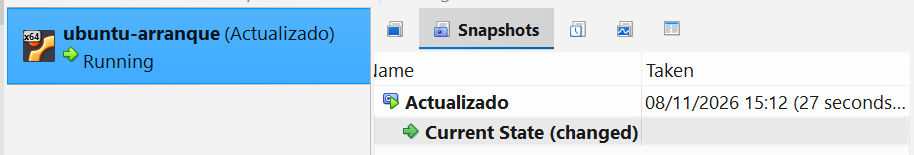

   En la lista, la máquina pasa a llamarse `ubuntu-arranque (Actualizado)`: muestra su última instantánea. El icono de cada instantánea dice cómo se tomó: con una flecha verde, con la máquina encendida; sin ella, apagada.

**Instantáneas y estado actual.** La lista de la pestaña *Snapshots* es un árbol con dos clases de elementos:

- Cada **instantánea** es una **foto fija** de la máquina en el momento de tomarla. No se enciende ni se cambia: queda tal cual para poder volver a ella.
- **Current State** (*Estado actual*) es la máquina **tal como está ahora**: la que se enciende y se usa. Cuelga de la última instantánea tomada o restaurada, y **todo lo que se hace con la máquina encendida se guarda aquí**, nunca en una instantánea.

Lo que se puede hacer depende de lo que esté seleccionado en la lista:

| Seleccionado | Qué se puede hacer |
|---|---|
| **Current State** | **Start**: encender la máquina; lo que se haga se guarda en el estado actual. **Take**: tomar una instantánea, una foto del estado actual. **Settings**: cambiar la configuración |
| Una **instantánea** | **Restore**: el estado actual pasa a ser una copia de esa foto, y lo hecho desde entonces se pierde (salvo que se marque *Create a snapshot of the current machine state*, que antes lo guarda en otra instantánea). **Delete**: borra la foto; el estado actual no cambia. **Clone**: crea otra máquina a partir de esa foto. Con una instantánea seleccionada, **Start** sale en gris |

Reglas prácticas:

- **Antes de encender la máquina, haz clic en Current State.**
- Toma y restaura las instantáneas con la máquina **apagada**: así guardan solo el disco y la configuración, y al volver a ellas la máquina arranca limpia.
- Ponles un nombre y una descripción que digan qué estado guardan: al restaurar hay que saber cuál elegir.

**Las instantáneas de este proyecto.** Son dos:

| Instantánea | Se toma en | Qué guarda | Para qué sirve |
|---|---|---|---|
| `Actualizado` | Paso 5 | El sistema recién actualizado, sin `tree`. GRUB todavía oculta el menú y la contraseña es la de la instalación | Volver a un sistema limpio si algo de los pasos 6 a 8 se estropea sin arreglo (se pierden los cambios de esos pasos) |
| `Antes de romper` | Paso 8, antes del `mv` | Lo anterior, más el menú de GRUB de 10 segundos (paso 6) y la contraseña nueva (paso 7). El arranque funciona | Recuperar el arranque en el paso 8 sin perder los pasos 6 y 7 |

**Examinar una instantánea y diagnosticar el estado actual.** Sin depender de lo que se apuntó al tomarlas, VirtualBox permite averiguar qué guarda cada instantánea y de dónde parte el estado actual:

1. **Sus datos.** Selecciona una instantánea: debajo del árbol salen su nombre, la fecha y hora en que se tomó y su descripción; en la pestaña de detalles, la configuración que tenía la máquina entonces (memoria, discos…). Clic derecho → **Properties** para cambiar el nombre o la descripción.
2. **De dónde parte el estado actual.** **Current State** cuelga de la última instantánea que se tomó o se restauró: el estado actual es esa foto más lo hecho después. Si aparece como **Current State (changed)**, ha habido cambios desde esa instantánea. El nombre de la máquina en la lista de la izquierda también la indica: `ubuntu-arranque (Actualizado)`.
3. **La lista completa, desde la terminal de Windows** (PowerShell):

   ```
   & "C:\Program Files\Oracle\VirtualBox\VBoxManage.exe" snapshot ubuntu-arranque list --details
   ```

   Sale el árbol de instantáneas con el nombre y la descripción de cada una; la marcada con `*` es la instantánea de la que parte el estado actual.
4. **Mirar dentro de una instantánea sin restaurarla.** Restaurar cambia el estado actual; para examinar una instantánea sin tocarlo, se crea una máquina a partir de ella: clic derecho en la instantánea → **Clone…**, nombre (por ejemplo `prueba-instantanea`), tipo **Linked Clone** (*Clon enlazado*, que no copia el disco entero y se crea en segundos) y **Finish**. Arranca esa máquina nueva y comprueba lo que haga falta, por ejemplo `ls /boot/grub` (¿está `grub.cfg`?) o `grep GRUB_TIMEOUT /etc/default/grub` (¿menú oculto o de 10 segundos?). Al terminar, apágala y bórrala: clic derecho en ella → **Remove…** → **Delete all files**. La máquina original y sus instantáneas no cambian.

**Comprueba que…**

- `apt update` termina sin errores y dice cuántos paquetes se pueden actualizar (o que todos están al día);
- con `tree` instalado ves el árbol de `/boot`, y después de quitarlo la orden ya no existe;
- en la pestaña *Snapshots* aparece `Actualizado` y, debajo, **Current State** (*Estado actual*).

**Si te falla…**

- *`Temporary failure resolving…` o `Could not resolve…`*: la máquina no tiene red. Comprueba en **Settings → Network** que el adaptador 1 está conectado a **NAT** y reinicia la máquina.
- *`Could not get lock /var/lib/dpkg/lock…`*: el sistema está instalando actualizaciones por su cuenta. Espera unos minutos y repite.
- *No ves el botón «Take»*: con la pestaña *Snapshots* abierta, usa el menú **Snapshot → Take…** (*Instantánea → Tomar…*), o **Ctrl+Mayús+T**.

---

## Paso 6 · El menú de GRUB

**Objetivo.** Que GRUB muestre su menú durante 10 segundos en cada arranque, en lugar de ocultarlo.

**Pista.** Arranca la máquina y entra. La configuración de GRUB está en `/etc/default/grub`. Primero, mírala:

```bash
cat /etc/default/grub
```

Busca estas dos líneas:

```
GRUB_TIMEOUT_STYLE=hidden
GRUB_TIMEOUT=0
```

Con un solo sistema, Ubuntu oculta el menú (`hidden`) y no espera nada (`0`). La primera línea del archivo avisa de que también cuentan los archivos de `/etc/default/grub.d/`. Edítalo con **nano**, el editor de texto del terminal. Se maneja solo con el teclado: las **flechas** mueven el cursor, se escribe donde está el cursor y **Retroceso** o **Supr** borran; abajo salen sus atajos (`^` es **Ctrl**):

```bash
sudo nano /etc/default/grub
```

Cambia esas dos líneas por estas:

```
GRUB_TIMEOUT_STYLE=menu
GRUB_TIMEOUT=10
```

Guarda (**Ctrl+O**, **Intro**) y sal (**Ctrl+X**). Ahora genera de nuevo la configuración que lee GRUB al arrancar:

```bash
sudo update-grub
```

```
Sourcing file `/etc/default/grub'
Sourcing file `/etc/default/grub.d/kdump-tools.cfg'
Generating grub configuration file ...
Found linux image: /boot/vmlinuz-7.0.0-43-generic
Found initrd image: /boot/initrd.img-7.0.0-43-generic
Found linux image: /boot/vmlinuz-7.0.0-30-generic
Found initrd image: /boot/initrd.img-7.0.0-30-generic
Warning: os-prober will not be executed to detect other bootable partitions.
…
Adding boot menu entry for UEFI Firmware Settings ...
done
```

`update-grub` lee `/etc/default/grub` (y `kdump-tools.cfg`, de donde sale el parámetro `crashkernel` del paso 4), encuentra los dos kernels y escribe `/boot/grub/grub.cfg`, que es lo que lee GRUB al arrancar ([apuntes de la UD2, apartado 8](../apuntes/UD2-sistemas-operativos.md#8-el-arranque-y-los-gestores-de-arranque)). El aviso de `os-prober` dice que GRUB no busca otros sistemas en otras particiones (un Windows en el mismo disco, por ejemplo): aquí no hay otro, así que es normal.

Reinicia:

```bash
sudo reboot
```

**Comprueba que…** al arrancar aparece el menú de GRUB, con una cuenta atrás y estas entradas:

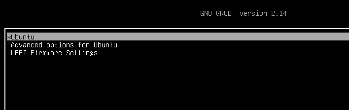

Si no tocas nada, al acabar la cuenta atrás arranca la primera, la marcada con `*`. Con las flechas se mueve la selección, y entonces la cuenta atrás se para.

**Si te falla…**

- *No aparece el menú*: no ejecutaste `sudo update-grub`, o lo hiciste antes de guardar. Vuelve a abrir el archivo, comprueba las dos líneas y repite.
- *`update-grub` da un error de sintaxis*: hay algo mal escrito en el archivo (por ejemplo, un espacio alrededor del `=`). Corrígelo y repite.
- *La cuenta atrás es de 30 segundos, no de 10*: el arranque anterior no terminó bien (por ejemplo, porque apagaste la máquina a mano) y GRUB da más tiempo para elegir. En cuanto un arranque termine bien, vuelve a los 10.

---

## Paso 7 · Opciones avanzadas, parámetros y modo de recuperación

**Objetivo.** Ver los parámetros que GRUB pasa al kernel, los kernels instalados y usar el modo de recuperación para cambiar una contraseña, como si se hubiera olvidado.

**Pista.**

1. **Lo que hace una entrada.** Reinicia (`sudo reboot`). En el menú de GRUB, pulsa una **flecha** (abajo y arriba) para parar la cuenta atrás y, con *Ubuntu* seleccionado, pulsa **e**. Se ve lo que hace esa entrada:

   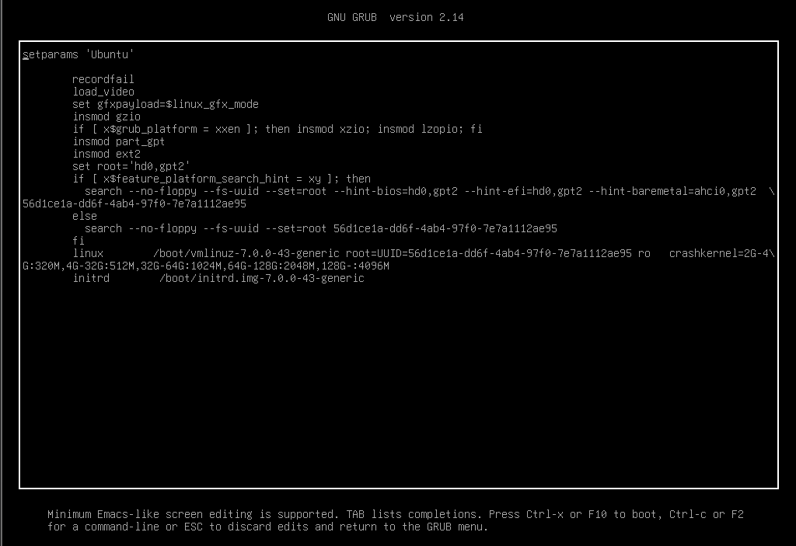

   - `set root='hd0,gpt2'`: GRUB busca los archivos en el disco 0, partición 2 GPT (la raíz, `sda2`);
   - `linux /boot/vmlinuz-… root=UUID=… ro crashkernel=…`: el kernel y sus parámetros, lo que se vio en el paso 4 con `cat /proc/cmdline`;
   - `initrd /boot/initrd.img-…`: su ayudante;
   - `recordfail`: GRUB anota el arranque, y Ubuntu lo da por bueno cuando termina. Por eso, tras un arranque que no terminó, el menú espera más.

   Aquí se podría cambiar algo **solo para este arranque**, sin guardarlo (abajo dice cómo: **Ctrl+X** o **F10** arranca con los cambios). No cambies nada: pulsa **Esc** para volver al menú.
2. **Las opciones avanzadas.** Entra en **Advanced options for Ubuntu**:

   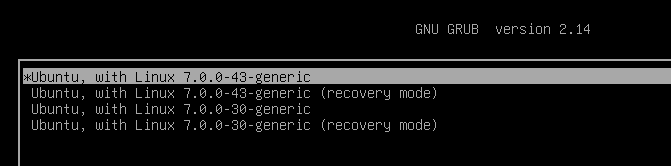

   Hay una entrada para cada kernel instalado y, debajo de cada una, la misma con `(recovery mode)`. El primero es el actual (aquí, `7.0.0-43`); el otro es el **anterior** (`7.0.0-30`): si una actualización instala un kernel que falla, se arranca desde aquí con el anterior.
3. **El modo de recuperación.** Elige **`Ubuntu, with Linux 7.0.0-43-generic (recovery mode)`**. Arranca un sistema mínimo y aparece el **Recovery Menu**:

   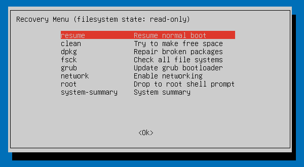

   Arriba dice `filesystem state: read-only`: el disco está en **solo lectura** (el `ro` de los parámetros). Las opciones sirven para reparar: `fsck` (comprobar el disco), `clean` (liberar espacio), `dpkg` (reparar paquetes), `grub` (actualizar GRUB), `network` (activar la red), `system-summary` (un resumen del sistema)… Elige **`root`** (*Drop to root shell prompt*). Sale `Press Enter for system maintenance`: pulsa **Intro**. Quedas en un terminal como administrador (`root@ubuntu-arranque:~#`), sin contraseña: por eso este modo solo está al alcance de quien tiene el ordenador delante.
4. **Cambiar la contraseña.** Primero hay que poder escribir en el disco. Después se cambia la contraseña de tu usuario (sustituye `alumno` por tu nombre de usuario). Son **dos órdenes**, cada una con su **Intro**:

   ```bash
   mount -o remount,rw /
   passwd alumno
   ```

   `mount` no dice nada si va bien. `passwd` pide la contraseña nueva dos veces (no se ve al escribirla) y termina con `passwd: password updated successfully`.
5. Sal con `exit`: vuelve el *Recovery Menu*. Elige **`resume`** (*Resume normal boot*) para seguir con el arranque normal y entra con la **contraseña nueva**.

**Comprueba que…**

- has visto la línea `linux` con los parámetros del kernel y las entradas de los dos kernels;
- en el modo de recuperación cambiaste la contraseña, y después entras con la contraseña **nueva**.

**Si te falla…**

- *En «Advanced options» solo hay un kernel*: el instalador no instaló actualizaciones del kernel. Todo lo demás funciona igual; el kernel anterior aparecerá cuando una actualización instale uno nuevo.
- *`mount: bad usage`*: has escrito las dos órdenes en la misma línea. Escribe `mount -o remount,rw /`, **Intro**, y después `passwd` con tu usuario.
- *`passwd: Authentication token manipulation error`*: el disco sigue en solo lectura. Falta `mount -o remount,rw /`.
- *`passwd: user 'alumno' does not exist`*: escribe tu nombre de usuario, el del paso 3.
- *Al pulsar `root` pide una contraseña de mantenimiento*: pulsa **Intro**. Si no deja continuar, sal con **Ctrl+D**, elige `resume` y repite desde el menú de GRUB.

---

## Paso 8 · Romper el arranque y recuperarlo

**Objetivo.** Ver qué pasa cuando GRUB no encuentra su configuración y volver al estado anterior con una instantánea.

**Pista.**

1. **Toma otra instantánea**, como en el paso 5: apaga con `sudo poweroff` y, en la pestaña *Snapshots*, **Take**, con el nombre **`Antes de romper`** y, en *Description*, `Paso 8: menú de GRUB de 10 s y contraseña nueva del paso 7. Arranque sin romper`.
2. **Rompe el arranque a propósito.** Antes de iniciar, haz clic en **Current State** en la lista de instantáneas, para trabajar sobre el estado actual y no sobre `Antes de romper`. Inicia la máquina, entra y cambia el nombre del archivo de configuración de GRUB, para que no lo encuentre. Después, reinicia:

   ```bash
   sudo mv /boot/grub/grub.cfg /boot/grub/grub.cfg.roto
   sudo reboot
   ```

3. En lugar del menú aparece **`grub>`**: GRUB ha arrancado (la **fase 2** empieza), pero sin su configuración no sabe qué kernel cargar. Es la consola de GRUB. Escribe `ls` e **Intro**:

   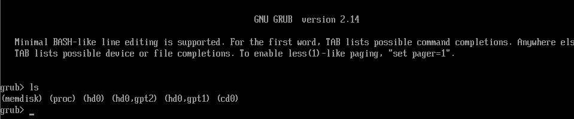

   Lista lo que ve: `(hd0)`, el disco; `(hd0,gpt1)`, la partición EFI; `(hd0,gpt2)`, la raíz; `(cd0)`, el DVD; y `(memdisk)` y `(proc)`, discos internos del propio GRUB, en memoria. Desde aquí se podría arrancar a mano, pero lo práctico es volver al estado anterior.

   `grub>` dice que GRUB ha arrancado pero no tiene su configuración: el fallo está en la fase 2. Qué se ve cuando falla cada fase: «Compara», en el [apartado 8 de los apuntes de la UD2](../apuntes/UD2-sistemas-operativos.md#8-el-arranque-y-los-gestores-de-arranque).

4. **Apaga la máquina:** **File → Close… → Power off the machine**.
5. **Restaura la instantánea.** En la ventana principal de VirtualBox, pestaña *Snapshots*: clic derecho en **`Antes de romper`** → **Restore…** (*Restaurar*). El cuadro ofrece guardar antes el estado actual (**Create a snapshot of the current machine state**): déjalo **desmarcado**, porque el estado actual es el roto, y pulsa **Restore**.

   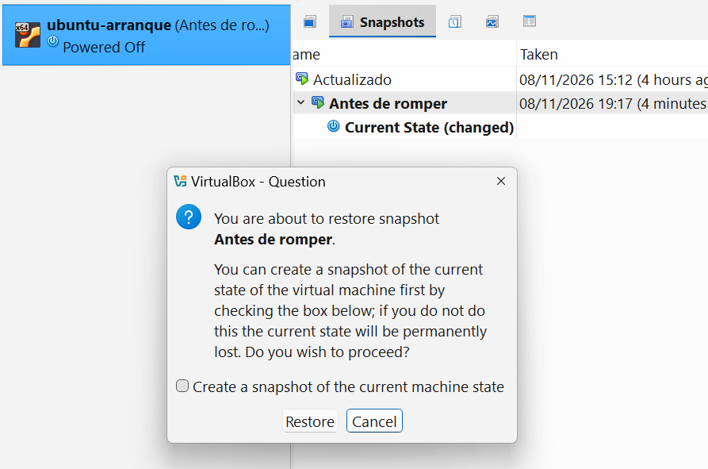

6. **Inicia la máquina.** Restaurar no la enciende: la deja apagada, como estaba al tomar la instantánea. Haz clic en **Current State** (o en la máquina, a la izquierda) y pulsa **Start**: con una instantánea seleccionada, *Start* sale en gris.

**Comprueba que…**

- después de romperlo sale `grub>` en lugar del menú;
- después de restaurar, arranca otra vez con el menú de GRUB del paso 6 y entras con la contraseña nueva del paso 7.

**Si te falla…**

- *Después de romperlo arranca igual que siempre*: no has escrito bien la ruta en `mv`. Comprueba con `ls /boot/grub` que ya no existe `grub.cfg`.
- *Después de restaurar sigue saliendo `grub>`*: has restaurado otra instantánea o no la has restaurado. Apaga la máquina y restaura `Antes de romper`.
- *No tienes la instantánea `Antes de romper`, o al restaurarla también sale `grub>`*: lo segundo pasa si la instantánea guardó el arranque ya roto. Una instantánea es una foto del disco en el momento de tomarla y no cambia después: todo lo que se hace con la máquina encendida, también el `mv`, va al estado actual (*Current State*). Así que la foto se tomó **después** del `mv`, o se está restaurando otra: por ejemplo, la que crea la casilla *Create a snapshot of the current machine state* si se marca al restaurar, que guarda el estado roto. Por eso el orden es: apagar, **Take**, iniciar y, solo entonces, romper; y al restaurar, esa casilla desmarcada. Para salir de ahí, se puede arrancar desde la propia consola, porque la configuración no se ha borrado, solo ha cambiado de nombre. En `grub>`, escribe `ls /boot/grub/` (tiene que salir `grub.cfg.roto`) y después `configfile /boot/grub/grub.cfg.roto`: aparece el menú de siempre. Arranca Ubuntu, entra y devuélvele el nombre con `sudo mv /boot/grub/grub.cfg.roto /boot/grub/grub.cfg` y `sudo reboot`. Si `ls` no encuentra el archivo, usa la ruta completa: `configfile (hd0,gpt2)/boot/grub/grub.cfg.roto`. Después, toma otra instantánea con la máquina apagada.
- *En `grub>` las teclas no escriben lo que pone en ellas (no salen `/`, `-`, `(`…)*: el teclado no envía letras, sino el **número de la tecla** pulsada; la **distribución de teclado** (española, estadounidense…) es la tabla que traduce cada número al carácter. Esa tabla la configura el sistema operativo, y GRUB se ejecuta **antes** de que Linux arranque: no conoce la distribución española y usa la estadounidense, que es la que trae por defecto (lo mismo pasa en la configuración del firmware). Las letras y los números están en el mismo sitio; cambian los símbolos. Con un teclado español:

  | Para escribir | Pulsa |
  |---|---|
  | `/` | la tecla `-` (a la derecha del punto) |
  | `-` | la tecla `'` (a la derecha del 0) |
  | `_` | **Mayús** + la tecla `'` |
  | `=` | la tecla `¡` (a la izquierda de Retroceso) |
  | `(` y `)` | **Mayús+9** y **Mayús+0** |
  | `:` | **Mayús** + la tecla `ñ` |
  | `"` | **Mayús** + la tecla de la tilde `´` (a la derecha de la `ñ`) |
  | `*` | **Mayús+8** |
  | `\` | la tecla `ç` |

  Ante la duda, escribe el carácter, mira qué sale en pantalla y bórralo con **Retroceso** si no es el que buscabas.
- *Al iniciar sale `Failed to load unit 'vga'`*: la instantánea se tomó con la máquina encendida y VirtualBox no puede recuperar lo que había en memoria. En la ventana principal, pulsa **Discard** (*Descartar*), confirma y vuelve a iniciarla: el disco está bien.

---

## Paso 9 · Arrancar desde la ISO sin tocar lo instalado

**Objetivo.** Arrancar la máquina desde otro medio, la ISO, eligiéndolo en el menú de arranque del firmware, sin cambiar nada de lo instalado.

**Pista.** Es lo que en un ordenador real se hace para arrancar desde un USB: instalar otro sistema, usar uno de rescate o probar uno sin instalarlo.

**Este paso necesita la máquina con UEFI**, como se pide en el paso 1: la opción **UEFI Firmware Settings** de GRUB y el *Boot Manager* son del firmware UEFI. Compruébalo con la máquina apagada: en **Settings → System → Motherboard**, la casilla **Enable EFI** tiene que estar marcada.

1. Apaga la máquina (`sudo poweroff`) y vuelve a meter la ISO en el DVD virtual, como en el paso 3.
2. Inicia la máquina y, en el menú de GRUB, elige **UEFI Firmware Settings**: se abre la configuración del firmware del paso 2.
3. Entra en **Boot Manager**. Ahora hay cinco opciones, más que en el paso 2:

   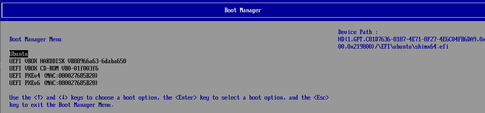

   - **`Ubuntu`**: la entrada del sistema instalado. A la derecha, su ruta termina en `\EFI\ubuntu\shimx64.efi`, como en `efibootmgr` (paso 4);
   - `UEFI VBOX HARDDISK …`: el disco;
   - **`UEFI VBOX CD-ROM …`**: el **DVD**, con la ISO;
   - `UEFI PXEv4` y `UEFI PXEv6`: la red.
4. Elige el **DVD** (`UEFI VBOX CD-ROM …`). Arranca la ISO y aparece su GRUB, el del paso 3: **Try or Install Ubuntu Server**. Es otro GRUB, el que va dentro de la ISO, no el del disco. También tiene cuenta atrás: pulsa una **flecha** para pararla y no elijas nada.
5. Quita la ISO: **Devices → Optical Drives → Remove Disk From Virtual Drive** y **Force Unmount**. Después apaga: **File → Close… → Power off the machine**.
6. Inicia la máquina: arranca, como siempre, desde el disco, con el menú de GRUB del paso 6.

Lo mismo valdría con la ISO de cualquier otro sistema, por ejemplo la de Windows: el firmware la arranca desde el DVD, igual que un USB de instalación en un ordenador real.

**Comprueba que…**

- en el *Boot Manager* aparecen la entrada `Ubuntu`, el disco, el DVD y la red, y sabes por qué ahora hay más que en el paso 2;
- desde el DVD arranca el GRUB de la ISO (*Try or Install Ubuntu Server*);
- sin la ISO, la máquina arranca otra vez desde el disco, con el menú de GRUB del paso 6.

**Si te falla…**

- *En el menú de GRUB no está «UEFI Firmware Settings»*: la máquina no tiene UEFI. Se creó sin marcar **Use EFI** en el paso 1 y arranca con BIOS heredada, que no tiene *Boot Manager*. Compruébalo en **Settings → System → Motherboard**: **Enable EFI** está desmarcada. **No la marques ahora**: Ubuntu se instaló para BIOS y dejaría de arrancar. Con BIOS, el menú de arranque se abre pulsando **F12** mientras sale el logo de VirtualBox; con la ISO puesta, elige el CD-ROM y sigue en el punto 4. Las particiones, `efibootmgr` y el firmware de los pasos 2 a 4 tampoco te habrán salido como se describen: para tenerlos, hay que crear la máquina de nuevo con **Use EFI** marcado (paso 1) y reinstalar.
- *En el Boot Manager no aparece el DVD*: no está puesta la ISO. Apaga, ponla y repite.
- *Del GRUB de la ISO pasa al instalador*: se acabó la cuenta atrás. No pasa nada: quita la ISO y apaga la máquina, como en el punto 5; el instalador no toca el disco hasta que se confirma en *Confirm destructive action*.

---

## Paso 10 · El arranque de Windows, en tu ordenador

**Objetivo.** Ver en tu propio Windows las mismas piezas del arranque que en Ubuntu, sin cambiar nada.

**Pista.** En este paso **solo se mira**. Es tu ordenador real: no cambies ninguna opción. Muchos ordenadores tienen el disco cifrado con **BitLocker**: si se cambian opciones del arranque o del firmware (como Secure Boot), al encender Windows puede pedir la **clave de recuperación de BitLocker**, y sin ella no se puede entrar.

Casi todo sale del menú del **clic derecho en el botón Inicio** (o **Windows + X**). Cuidado: **Device Manager** (*Administrador de dispositivos*) está justo encima de **Disk Management** (*Administración de discos*), y **Terminal** justo encima de **Terminal (Admin)**.

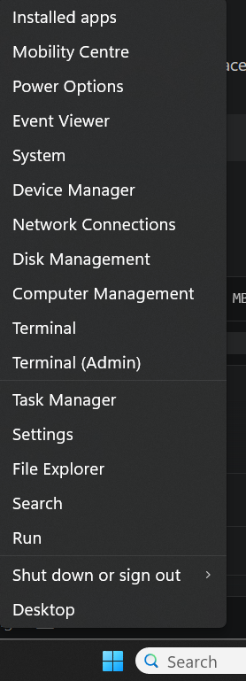

1. **Cómo arranca.** Pulsa **Windows + R**, escribe `msinfo32` e **Intro**. En **System Summary** (*Resumen del sistema*):
   - **BIOS Mode** (*Modo de BIOS*): `UEFI` en cualquier ordenador actual; `Legacy` (*Heredado*) es el modo BIOS antiguo;
   - **Secure Boot State** (*Estado de arranque seguro*): si está `On` (*Activado*), el firmware solo arranca programas firmados (por eso Ubuntu arranca con `shimx64.efi`, que está firmado);
   - **Boot Device** (*Dispositivo de arranque*): `\Device\HarddiskVolume1`, la partición EFI, la primera del disco.

   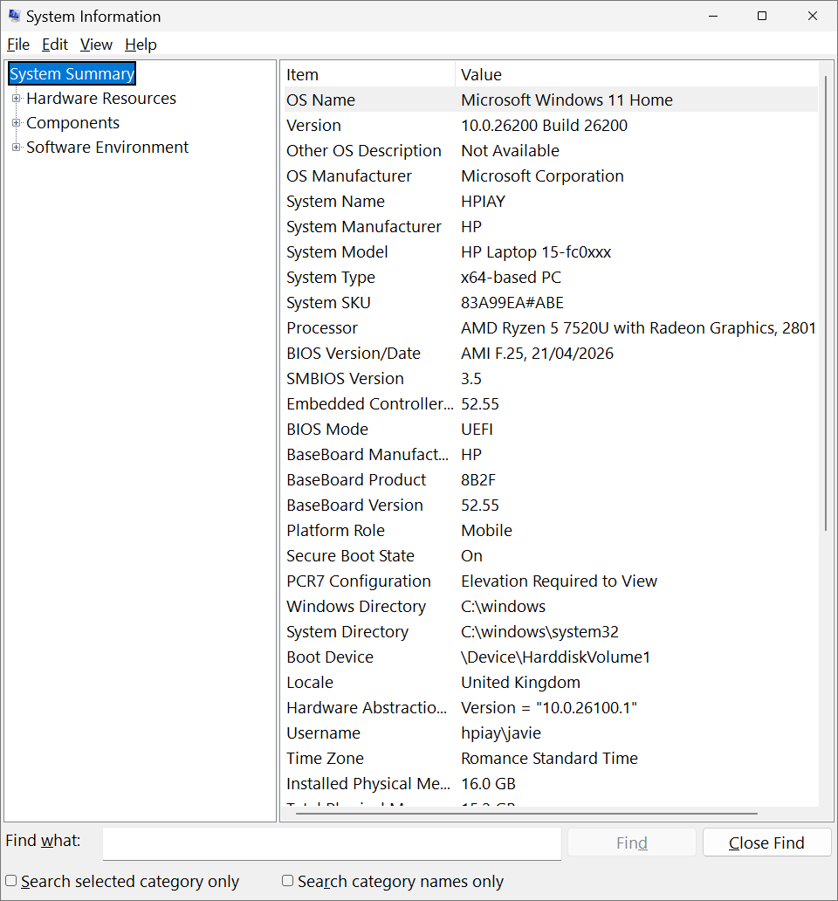

2. **Sus particiones.** Clic derecho en Inicio → **Disk Management** (*Administración de discos*). En el *Disk 0* verás la **partición de sistema EFI** (*EFI System Partition*, unos 100–300 MB), **`C:`** y la **partición de recuperación** (*Recovery Partition*, alrededor de 1 GB). La reservada de Microsoft (MSR) no aparece aquí, porque no tiene archivos. Compáralas con las de Ubuntu del paso 4. No hagas clic en ninguna opción de las particiones.

   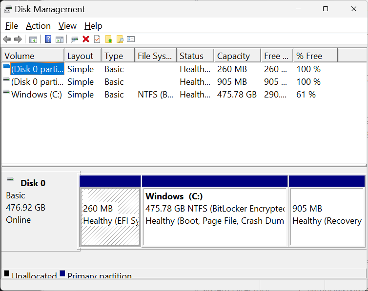

3. **Su gestor de arranque.** Clic derecho en Inicio → **Terminal (Admin)** y acepta el aviso. Escribe:

   ```
   bcdedit
   ```

   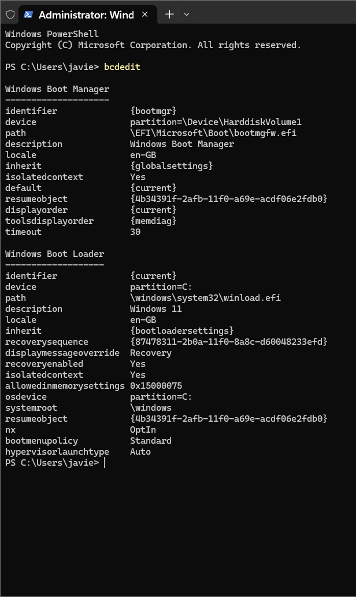

   Muestra el **BCD**, la configuración del arranque, en dos bloques:

   - **Windows Boot Manager** (*Administrador de arranque de Windows*): su `path` es `\EFI\Microsoft\Boot\bootmgfw.efi`, en la partición EFI (`\Device\HarddiskVolume1`). Es el equivalente a GRUB. Con un solo sistema, no muestra menú, como GRUB con `hidden`;
   - **Windows Boot Loader** (*Cargador de arranque de Windows*): su `path` es `\windows\system32\winload.efi`, que carga el kernel de Windows desde `C:`, como la línea `linux` de GRUB. En `recoverysequence` está el entorno de recuperación, como el *recovery mode* de GRUB.

   `bcdedit` solo **muestra** si se escribe solo. Con otras opciones (`/set`, `/delete`, `/default`…) cambia el arranque de tu ordenador: **no las uses aquí**.
4. **Las entradas del firmware.** En el mismo terminal:

   ```
   bcdedit /enum firmware
   ```

   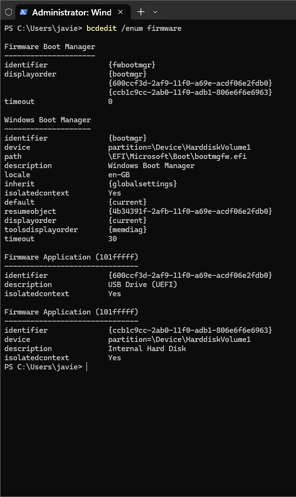

   La primera parte, **Firmware Boot Manager**, tiene un `displayorder` con las entradas de arranque de UEFI, en orden: **Windows Boot Manager** y, según el ordenador, otras (un USB, el disco, la red, o `ubuntu` si tiene arranque dual). Es lo mismo que mostró `sudo efibootmgr` en Ubuntu.

> **Si tu ordenador tiene Linux en lugar de Windows,** no puedes hacer este paso: estudia la parte de Windows de los apartados 7 y 8 de los apuntes de la UD2. Lo que sí puedes hacer es comparar: en tu Linux, `lsblk` y `sudo efibootmgr` muestran lo mismo que en la máquina virtual.

**Comprueba que…** sabes decir, en tu ordenador, el modo de arranque (UEFI o heredado), dónde está la partición EFI, cuál es el gestor de arranque de Windows y dónde está su configuración, y cuál es el equivalente de cada uno en Ubuntu.

**Si te falla…**

- *`bcdedit`: «Access is denied» o «No se pudo abrir el almacén de datos de la configuración de arranque»*: el terminal no está abierto como administrador. Ciérralo y abre **Terminal (Admin)**.
- *Se abre una lista de dispositivos en lugar de los discos*: es *Device Manager*. Ciérralo y elige **Disk Management**, justo debajo (o **Windows + R**, `diskmgmt.msc`).
- *En Administración de discos hay más particiones*: algunos fabricantes añaden la suya de recuperación o de herramientas. Las de Windows son las mismas.

---

## Entrega

Qué se entrega y cuándo: [`entrega.md`](entrega.md).

## Cómo comprobarlo (lista final)

| Comprobación | Hecho |
|---|---|
| Sé qué son el anfitrión, el hipervisor y el invitado, y qué archivos forman una máquina virtual |  |
| Sé a qué componente de un ordenador corresponde cada ajuste de la máquina, y lo reconozco en `lspci` |  |
| Sé nombrar las cinco fases del arranque, en orden, y qué hace cada una |  |
| La máquina usa UEFI, y vi qué hace el firmware sin nada que arrancar |  |
| Ubuntu Server está instalado, con la partición EFI en `/boot/efi` y la raíz en `/` |  |
| Sé señalar el programa de GRUB, la entrada de Ubuntu en el firmware, el kernel, sus parámetros y systemd con las órdenes del paso 4 |  |
| Actualicé el sistema e instalé y desinstalé un programa con `apt` |  |
| GRUB muestra su menú durante 10 segundos |  |
| Sé para qué sirve tener dos kernels y vi los dos en las opciones avanzadas |  |
| Cambié una contraseña desde el modo de recuperación |  |
| Rompí el arranque, vi `grub>` y lo recuperé con una instantánea |  |
| Arranqué la ISO desde el menú de arranque del firmware sin tocar lo instalado |  |
| Sé comparar el arranque de Windows con el de Ubuntu: firmware, partición EFI, gestor de arranque, su configuración y la recuperación |  |
